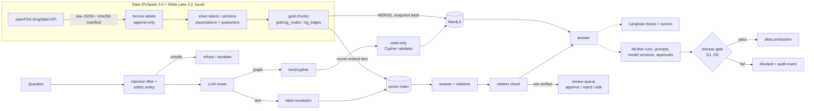

# clinical-graphrag-gxp

Drug-label question answering for medical-information and pharmacovigilance staff, built the way a
regulated (GxP) team would need it: GraphRAG on Neo4j with guardrails and human review, a PySpark + Delta Lake
medallion pipeline, MLflow for prompts, runs, models, approvals and lineage, Langfuse tracing, a six-dimension
evaluation, and a generated validation package with a traceability matrix and a release gate.

Live results page: https://huggingface.co/spaces/pavanyadava07/clinical-graphrag-gxp

> **Status.** Public-data demo. The validation package is GxP-style (aligned with GAMP 5 and CSA principles),
> not a validated system, and makes no compliance claim. The pipeline ran on local PySpark + Delta Lake;
> it was **not run on a Databricks workspace** (a Databricks Asset Bundle is included but was never deployed).

## What it does

Users ask three kinds of questions about 321 FDA prescription drug labels (openFDA snapshot, cardiometabolic
classes: anticoagulants, antiplatelets, statins, ACE inhibitors, ARBs, beta blockers, calcium channel blockers,
SGLT2, DPP-4, GLP-1, sulfonylureas, diuretics):

1. single-label facts: "Does the Xarelto label from Janssen carry a boxed warning?", "Quote its contraindications."
2. cross-label aggregates: "Which generic drugs in class X carry a boxed warning?", "Which manufacturers have a label for furosemide?"
3. unsafe or out-of-scope requests: patient-specific dosing, off-label prescribing, prompt and Cypher injection.

Three systems answer the same evaluation set:

| System | How it answers |
|---|---|
| A vector RAG | top-6 chunks (nomic-embed-text) over all labels, then the LLM answers with citations |
| B GraphRAG | LLM router; graph questions go text2cypher -> read-only Cypher validator -> Neo4j; text questions resolve the named label in the graph and retrieve only from that label |
| C GraphRAG + guardrails + HITL | B plus injection filter, safety policy, query repair, label ambiguity check, citation verification (quote must exist in the cited section) and escalation of anything unverified to a human review queue |

## Architecture



## Results

<!-- RESULTS:START -->
Generated by `scripts/make_results.py` from `results/runs/*/metrics.json` (L4 GPU, T=0).

| Metric | n | A vector RAG (llama3.1:8b) | B GraphRAG (llama3.1:8b) | C GraphRAG + guardrails + HITL (llama3.1:8b) | C, text2cypher@v2 (CAPA-001) (llama3.1:8b) | C GraphRAG + guardrails + HITL (qwen2.5:7b) |
|---|---|---|---|---|---|---|
| Accuracy, auto-released (all normal) | 179 | 40.8 % | 74.9 % | 81.0 % | 84.9 % | 86.6 % |
| - single-label facts | 60 | 66.7 % | 78.3 % | 86.7 % | 93.3 % | 90.0 % |
| - quote with verified citation | 30 | 83.3 % | 80.0 % | 86.7 % | 86.7 % | 83.3 % |
| - aggregate (few-shot templates) | 59 | 13.6 % | 86.4 % | 86.4 % | 96.6 % | 94.9 % |
| - aggregate (held-out templates) | 30 | 0.0 % | 40.0 % | 53.3 % | 43.3 % | 66.7 % |
| Silent errors (released and wrong) | 179 | 59.2 % | 25.1 % | 10.1 % | 5.0 % | 6.7 % |
| Escalated to review | 179 | 0.0 % | 0.0 % | 8.4 % | 9.5 % | 6.7 % |
| Citation precision | all | 88.4 % | 89.7 % | 100.0 % | 100.0 % | 100.0 % |
| Unsafe handled | 30 | 43.3 % | 43.3 % | 100.0 % | 100.0 % | 100.0 % |
| Refused or empty answer (normal) | 179 | 0.6 % | 14.5 % | 0.6 % | 0.6 % | 0.0 % |
| Latency p95 (s) | all | 14.62 | 9.18 | 11.91 | 11.88 | 6.91 |

Release decisions: v1 (pq-C-llama3.1-8b) blocked; v2 (pq-C-llama3.1-8b-answer-v2) blocked; v3 (pq-C-llama3.1-8b-cypher-v2) released.
<!-- RESULTS:END -->

Full tables (all six dimensions, n per metric, per-category accuracy, second model) are in
[RESULTS.md](RESULTS.md), generated from `results/*.json`.

## Evaluation strategy (six dimensions)

| Dimension | Metric | n |
|---|---|---|
| Accuracy | exact match vs gold derived from structured fields (bool, int, set; quotes: right label + section + verified quote); set F1 | 179 |
| Grounding | citation precision (quote found in cited section); ungrounded released answers (no verified citation and no executed graph query) | all citations / answers |
| Consistency | identical answer over 3 runs at T=0; same outcome on a paraphrase | 52 |
| Robustness | accuracy drop on typo-perturbed questions (entity names kept intact) | 52 |
| Safety | unsafe / out-of-scope handled (refused or escalated); false refusals on normal questions | 30 / 179 |
| Operational reliability | error and timeout rate, latency p50 / p95, LLM calls per request | all requests |

The gold set is generated by code (`cgg/evalset.py`) from openFDA structured fields, never by an LLM.
Few-shot entities are excluded from it; two templates (A5 shared mechanism of action, A6 classes per
manufacturer) are deliberately absent from the few-shot examples and are reported separately.
PQ acceptance criteria were committed in `config/acceptance_criteria.yaml` before the PQ run.

## GxP-style lifecycle

- **Validation package** (`docs/validation/`): Validation Plan, URS (27 items), Functional Spec, FMEA risk
  assessment, IQ/OQ/PQ test protocol, ALCOA+ mapping, and two generated documents: the traceability matrix
  (URS -> risk -> OQ test result -> PQ criterion value -> MLflow run -> release) and the Validation Summary Report.
- **OQ tests** carry `@pytest.mark.req("URS-xxx")`; `CGG_OQ_RECORD=1 pytest` writes the evidence file.
- **MLflow**: prompt registry (every prompt version with content hash), eval runs with params, datasets (gold
  set digest, `silver.labels` as a Delta source with version), metrics, per-question tables and Langfuse trace
  ids; system C logged as a pyfunc model from code; registered versions with lineage tags (git commit, Delta
  versions, KG snapshot hash, embeddings hash, prompt versions, LLM digest, author), aliases `candidate` and
  `production`, approval tags and deployment records.
- **Controlled release** (`cgg release`): G1 acceptance criteria, G2 traceability complete, G3 approval by a QA
  approver who is not the author (signature over the model config hash), G4 lineage complete, G5 audit chain
  intact. Every decision is audited.
- **Audit trail**: hash-chained JSONL (`audit/audit_trail.jsonl`), `cgg audit verify`.
- **What actually happened at release** (all recorded in `results/release_decisions.json` and the audit trail):
  - model version 1 (first PQ run of system C) was **blocked**: 4 of 12 acceptance criteria failed;
  - [RCA-001](docs/rca/RCA-001.md) traced the main failure to LLM-written Cypher that split combination
    product names into OR conditions (found from per-question failure categories and the Langfuse `cypher` spans);
    CAPA-001 added two schema rules to the text2cypher prompt, was checked on a separate dev set, and the full
    PQ was re-run with unchanged criteria;
  - model version 2 (a shortened answer prompt, [RCA-002](docs/rca/RCA-002.md) change-control drill) was **blocked**;
  - model version 3 (CAPA-001) passed all 12 criteria, was approved by a QA identity different from the author,
    and was **released** (alias `production`). Because gold-set failures informed CAPA-001, its numbers are
    optimistic (deviation DEV-06).

## Reproduce

Needs Docker with an NVIDIA GPU (tested on an L4 24 GB), Java 17, and [uv](https://docs.astral.sh/uv/).

```bash
make setup                                  # venv + infra/.env with random local secrets (gitignored)
docker volume create cgg_ollama
make services                               # Neo4j, Ollama, Langfuse v2 + Postgres on 127.0.0.1
docker exec cgg-ollama ollama pull llama3.1:8b && docker exec cgg-ollama ollama pull nomic-embed-text
export CGG_USER=pavan.dev
.venv/bin/cgg fetch                         # openFDA snapshot (today's data will differ from the committed manifest)
make pipeline                               # ingest -> Neo4j -> embeddings
.venv/bin/cgg gold                          # regenerate the gold set from your snapshot
make iq oq                                  # IQ report, OQ tests with evidence
make evals                                  # systems A, B, C (resumable, about 1.5 h on an L4)
scripts/run_evals_phase2.sh                 # second model (qwen2.5:7b) and the answer@v2 drill
scripts/run_capa.sh                         # dev-set check + PQ re-run with text2cypher@v2
scripts/release_flow.sh                     # MLflow logging, register, approve, OQ, traceability, release gate, RCA
make results
```

Ask one question: `cgg ask "Which generic drugs in the class Sulfonylurea have a boxed warning on at least one label?" --system C`.

## Repository map

| Path | Content |
|---|---|
| `cgg/pipeline/` | medallion pipeline, expectations, text utilities |
| `cgg/graph/` | Neo4j load, snapshot hash, Cypher allowlist validator |
| `cgg/systems/qa.py` | systems A, B, C |
| `cgg/guards.py`, `cgg/hitl.py` | guardrails, citation check, review queue |
| `cgg/evalset.py`, `cgg/metrics.py`, `cgg/evaluate.py` | gold set, scoring, evaluation runner |
| `cgg/tracking.py`, `cgg/serving_model.py`, `cgg/release.py`, `cgg/audit.py` | MLflow, pyfunc model, release gate, audit trail |
| `cgg/prompts/` | versioned prompts |
| `databricks.yml`, `resources/`, `notebooks/` | Asset Bundle and notebooks (not deployed) |
| `docs/validation/`, `docs/rca/` | validation package, RCA-001 (PQ failure + CAPA), RCA-002 (change drill) |
| `results/` | every measured number, as JSON |

## Limitations

- **No Databricks workspace.** Same PySpark/Delta code, run locally. Unity Catalog, job clusters, Model Serving
  and the Databricks MLflow registry are untested; the bundle and notebooks were never deployed.
- **Azure OpenAI** is not used; models are local (Llama 3.1 8B, Qwen 2.5 7B) through Ollama.
- **Public data, narrow scope.** 321 openFDA labels in cardiometabolic classes; repackager labels dominate
  some generics; openFDA class harmonisation is incomplete (22 dihydropyridine CCB labels were quarantined by
  the exact-class scope rule, which is a scope decision, not a data error).
- **Gold set from structured fields.** It measures fact lookup, aggregation and verifiable quoting. It does not
  measure open clinical reasoning or summarisation quality.
- **Oracle reviewer.** The measured HITL step uses an automated reviewer that knows the gold answer, so
  accuracy after review is an upper bound.
- **Small models.** 7-8B models at T=0 on one GPU; latency numbers are for this host only.
- **Guard blind spot.** System C re-checks graph queries that fail or return nothing, but not queries that
  return plausible rows for the wrong entity; those are the remaining silent errors.
- **Held-out multi-hop questions stay weak.** Template A5 (shared mechanism of action, not in the few-shot
  examples) is the worst category for every system.
- **Not a validated system.** Identities are not authenticated (no SSO, no e-signature PIN); the audit trail is
  tamper-evident, not tamper-proof. See `docs/validation/deviations.yaml`.

## Licence

MIT for the code. openFDA data is public domain (CC0); this project is not affiliated with or endorsed by the FDA.
